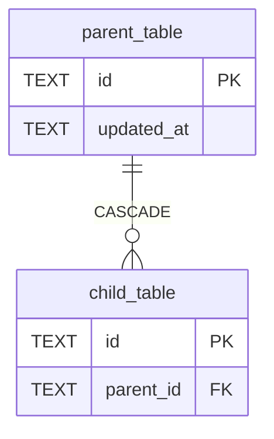

# Data Model & Database Schema

<!-- Replace this paragraph with a concise summary of the persistence layer, database engine, and schema scope. -->
This document defines the relational database schema, entity relationships, foreign key constraints, indexing strategy, and query mechanics for the <application name> application.

## Storage Engine & Runtime Isolation

- **Database Engine & ORM**: <e.g., SQLite via better-sqlite3 and Drizzle ORM, with WAL mode and foreign key enforcement>.
- **Environment Isolation**: <Explain how development, test, and production databases are separated and seeded>.
- **Data Representation Conventions**: <Explain how monetary values, dates, and timestamps are stored>.

---

## Entity-Relationship Diagram

---

## Table Specifications

### 1. `<table_name>`
<One-sentence summary of the table's role and cascade behavior.>

| Column | Type | Constraints / Default | Description |
|--------|------|-----------------------|-------------|
| `<column_name>` | `<SQL type>` | `<PRIMARY KEY / NOT NULL / REFERENCES ...>` | <Concise description of the column> |

---

## Indexing, Virtual Tables & Custom Functions

### 1. B-Tree Indexes

| Index Name | Table & Columns | Query Purpose |
|------------|-----------------|---------------|
| `<index_name>` | `<table(col1, col2)>` | <What queries or operations this index accelerates> |

### 2. Virtual Tables & Triggers
<!-- Omit if the application does not use FTS virtual tables, triggers, or custom SQL functions. -->
- <Describe virtual tables, synchronization triggers, and custom registered SQL functions>.
